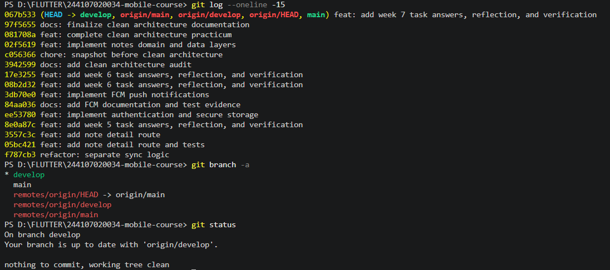
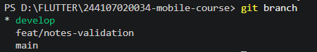
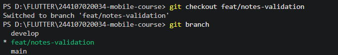
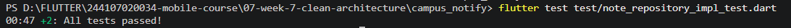
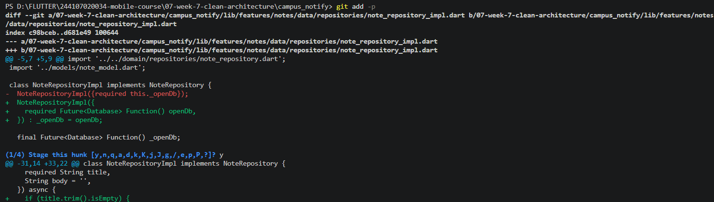
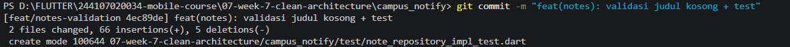
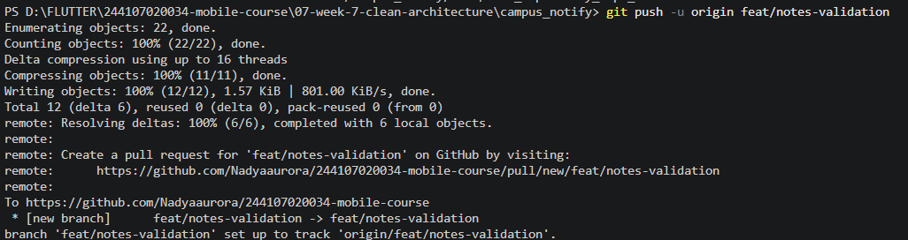
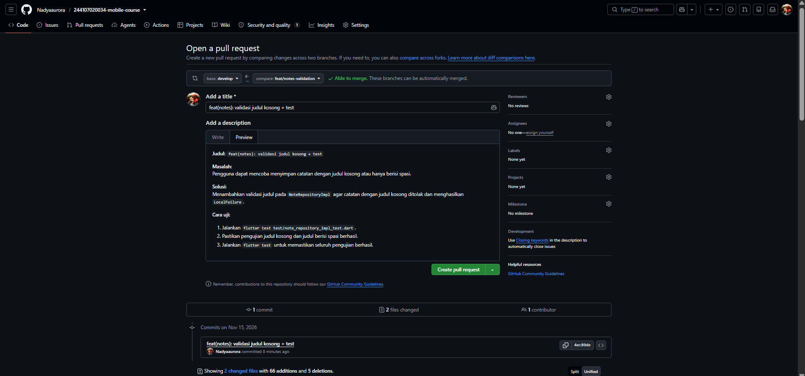
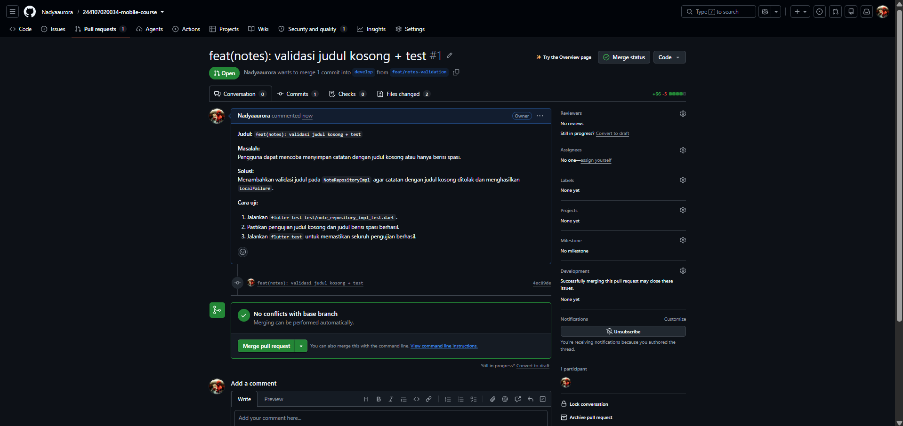

# Week 8 - Mid Project Review

**Nama:** Nadya Aurora Gebi Agista

**NIM:** 244107020034

---

## Praktikum 1 — Audit dan Simulasi Perbaikan Commit

Praktikum ini berfokus pada pemeriksaan riwayat Git, penggunaan branch, serta simulasi perbaikan pesan commit.

### 1. Hasil Audit Repository

Pemeriksaan dilakukan terhadap 15 commit terakhir pada project Week 7.

| Aspek | Hasil |
|---|---|
| Riwayat commit | Memeriksa 15 commit terakhir |
| Penggunaan branch | Ditemukan pekerjaan yang sebelumnya dilakukan langsung pada `main` |
| Pesan commit | Tidak ditemukan pesan `fix bug` atau `update` |
| Branch | Membuat `develop` dan `feat/notes-validation` |
| Status repository | Working tree bersih saat pemeriksaan awal |

**Bukti Audit Git**

| Audit Riwayat Git | Daftar Branch |
|---|---|
|  |  |

### 2. Simulasi Perbaikan Commit

Tiga pesan commit lama ditulis ulang sebagai usulan menggunakan format Conventional Commits. Simulasi ini tidak mengubah riwayat Git asli.

| Sebelum | Usulan Perbaikan |
|---|---|
| `feat: add week 7 task answers, reflection, and verification` | `docs(week-7): add task answers, reflection, and verification` |
| `feat: complete clean architecture practicum` | `feat(week-7): complete clean architecture implementation` |
| `feat: add note detail route` | `feat(notes): add note detail route` |

### 3. Implementasi Perbaikan

Perbaikan dilakukan pada fitur notes dengan menambahkan validasi untuk menolak judul kosong maupun judul yang hanya berisi spasi. Pengujian unit juga dibuat untuk memastikan validasi tersebut berjalan dengan benar.

**Bukti Implementasi**

| Branch Aktif | Implementasi Validasi |
|---|---|
|  |  |

| Hasil Unit Test | Git Diff |
|---|---|
|  |  |

| Commit Feature | Push Feature |
|---|---|
|  |  |

---

## Praktikum 2 — Pull Request dan Code Review

### 1. Pembuatan Pull Request

Pull Request dibuat dari branch `feat/notes-validation` menuju `develop`.

**Judul PR:**

`feat(notes): validasi judul kosong + test`

Perubahan mencakup penambahan validasi judul catatan dan pengujian untuk input kosong serta input yang hanya berisi spasi.

### 2. Hasil Review

Pemeriksaan dilakukan terhadap kebenaran implementasi, arsitektur, pengujian, dan keterbacaan kode.

| Aspek | Hasil |
|---|---|
| Kebenaran | Judul kosong dan judul berisi spasi berhasil ditolak |
| Arsitektur | Validasi berada pada `NoteRepositoryImpl` |
| Pengujian | Tersedia pengujian untuk dua kondisi judul tidak valid |
| Keterbacaan | Struktur dan penamaan kode cukup jelas |

Review dilakukan secara mandiri karena tidak menggunakan reviewer lain. Keputusan yang diberikan adalah **Approve**, dengan beberapa saran pengembangan untuk tahap berikutnya.

### 3. Merge Pull Request

Pull Request berhasil di-merge menggunakan metode squash ke branch `develop`. Setelah proses merge, branch feature lokal dan remote dihapus.

**Bukti Pull Request**

| Form Pembuatan PR | Pull Request Dibuat |
|---|---|
|  |  |

---

## Praktikum 3 — Static Analysis dan Continuous Integration

### 1. Pemeriksaan Kualitas Kode

Pemeriksaan dilakukan menggunakan Flutter Analyze, Dart Formatter, dan Flutter Test.

| Pemeriksaan | Hasil |
|---|---|
| `flutter analyze` | Tidak ditemukan masalah pada pemeriksaan terakhir |
| `dart format --set-exit-if-changed lib test` | 27 file diperiksa dan 15 file diformat |
| `flutter test` | 13 test berhasil |

### 2. Pemeriksaan Struktur Arsitektur

Pemeriksaan dilakukan untuk memastikan pemisahan tanggung jawab pada struktur feature-first.

| Aspek | Kriteria |
|---|---|
| Domain | Tidak bergantung langsung pada Flutter |
| Presentation | Tidak mengakses database secara langsung |
| Repository | Implementasi repository berada pada data layer |

### 3. Konfigurasi GitHub Actions

Workflow CI dibuat melalui file `.github/workflows/ci.yml` pada root repository.

Workflow dikonfigurasi untuk berjalan ketika terdapat Pull Request dengan tahapan checkout repository, menyiapkan Flutter, menjalankan `flutter analyze`, dan menjalankan `flutter test`.

---

## AI Challenge

Dokumentasi AI Challenge mencakup prompt yang digunakan, hasil awal AI, keputusan yang diambil, serta penyesuaian berdasarkan kebutuhan project.

Dokumentasi lengkap dapat dilihat pada [AI Review vs Keputusan Teknis](docs/ai-review-vs-keputusan.md).

---

## Struktur Folder

```text
08-week-8-mid-project-review/
├── docs/
│   └── review-checklist.md
├── screenshots/
│   ├── 01-audit-git.png
│   ├── 02-daftar-branch.png
│   ├── 03-branch-aktif.png
│   ├── 04-implementasi-validasi.png
│   ├── 05-unit-test.png
│   ├── 06-git-diff.png
│   ├── 07-commit-feature.png
│   ├── 08-push-feature.png
│   ├── 09-pr-create.png
│   └── 10-pr-created.png
└── README.md
```

Workflow CI berada di root repository, yaitu `.github/workflows/ci.yml`, di luar folder Week 8.

---

## Kesimpulan

Melalui praktikum Week 8, dilakukan perbaikan alur pengembangan melalui penggunaan branch, commit yang lebih terstruktur, serta Pull Request. Fitur notes juga diperbaiki dengan menambahkan validasi dan pengujian unit.

Selain itu, pemeriksaan kualitas kode dilakukan menggunakan Flutter Analyze, Dart Formatter, dan Flutter Test. Konfigurasi GitHub Actions turut ditambahkan sebagai dasar otomatisasi pemeriksaan kode pada Pull Request.