# Week 9 - AI-Assisted Development / Vibe Coding

**Nama:** Nadya Aurora Gebi Agista

**NIM:** 244107020034

---

## Praktikum 1 — Prompt dan Context Engineering

Praktikum ini berfokus pada perancangan instruksi (*prompt*) terstruktur dan penyediaan konteks teknis (*context engineering*) agar kode hasil AI mematuhi Clean Architecture dan mudah diuji.

### 1. Desain Prompt Formula 5 Slot

| Slot | Komponen | Deskripsi |
|---|---|---|
| **Peran** | Role AI | Senior Flutter Developer spesialis Clean Architecture dan Riverpod. |
| **Konteks** | Lingkungan | Feature-first Clean Architecture, `flutter_riverpod: ^3.5.0`, SQLite, dan Dio. |
| **Tugas** | Fitur Baru | Menambahkan pencarian judul catatan (case-insensitive) dan *empty state*. |
| **Batas** | Aturan Arsitektur | Tidak memanggil SQLite dari widget; isolasi filter ke domain use case (< 40 baris). |
| **Output** | Hasil | Use case domain, Riverpod provider, integrasi UI, dan unit test. |

### 2. Context Engineering dan Sanitasi Secret

Konteks teknis yang diberikan mencakup struktur folder `lib/features/notes/`, kontrak `NoteRepository`, entitas `Note`, dan versi package pada `pubspec.yaml`. Seluruh data sensitif seperti token FCM (`FCM_TOKEN_PLACEHOLDER`) dan token JWT (`JWT_TOKEN_PLACEHOLDER`) disensor sebelum prompting.

Dokumentasi lengkap log prompt dapat dilihat pada [AI Development Log](docs/ai-log.md).

---

## Praktikum 2 — Generate dan Verifikasi Search

Praktikum ini mencakup implementasi fitur pencarian catatan, penerapan verifikasi 6 langkah, serta pembuktian bug/halusinasi AI.

### 1. Verifikasi dan Temuan Bug AI

1. **Halusinasi String Matching:** AI mengusulkan `title.contains(query)` yang peka huruf besar/kecil. Bug dibuktikan melalui unit test yang gagal mencari `"belanja"` pada judul `"Belanja Bulanan"`, kemudian diperbaiki dengan normalisasi lowercase dan trim.
2. **Halusinasi Versi Package:** AI mengusulkan `StateProvider` yang sudah usang pada Riverpod 3.x, sehingga memicu error pada `flutter analyze` sebelum direfaktor ke `NotifierProvider`.
3. **Penyempurnaan UI:** Form catatan dipindahkan ke *Modal Bottom Sheet* via tombol *Floating Action Button*, serta ditambahkan *badge* status sinkronisasi dan tombol hapus catatan.

### 2. Bukti Verifikasi Mesin Praktikum 2

| Flutter Analyze Praktikum 2 | Flutter Test Praktikum 2 |
|:---:|:---:|
| 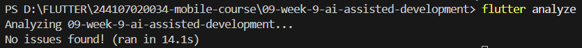 | 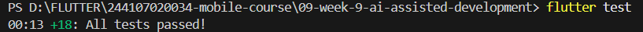 |

### 3. Bukti Pengujian Manual Fitur Pencarian

| 01 - Daftar Catatan | 02 - Search Cocok | 03 - Search Empty State |
|:---:|:---:|:---:|
| 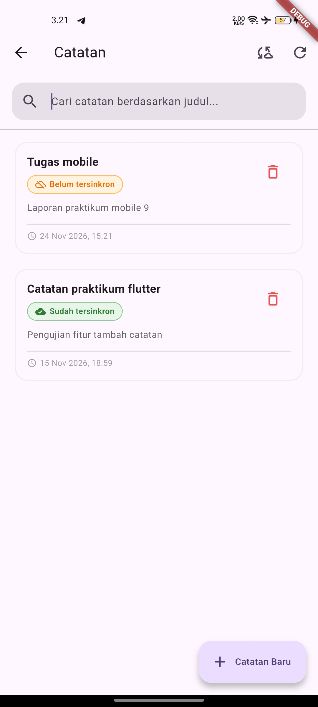 | 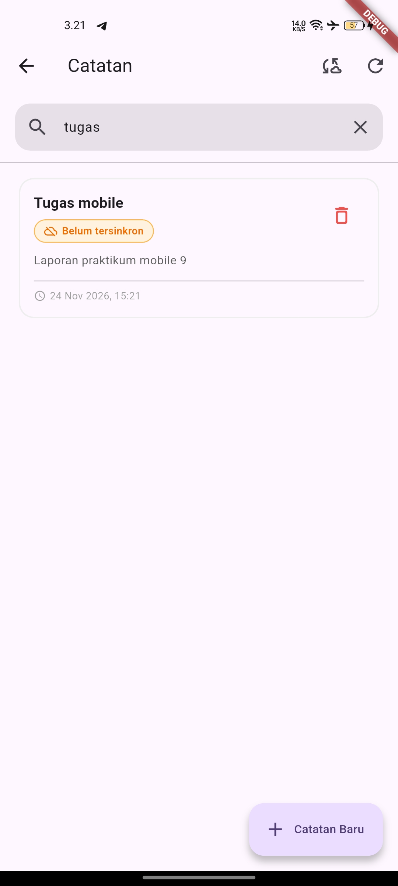 | 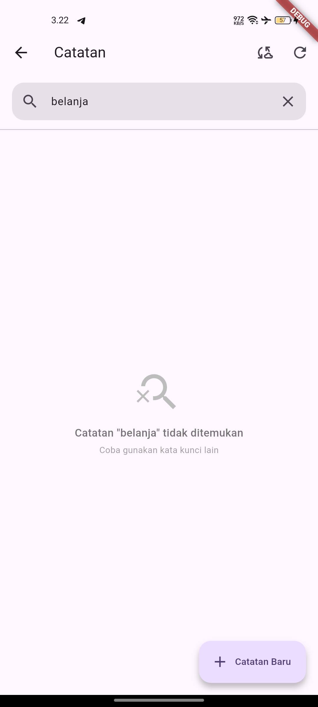 |

### 4. Bukti Fitur Pendukung (Hapus & Sinkronisasi)

| 04 - Dialog Hapus Catatan | 05 - Sinkronisasi Catatan |
|:---:|:---:|
| 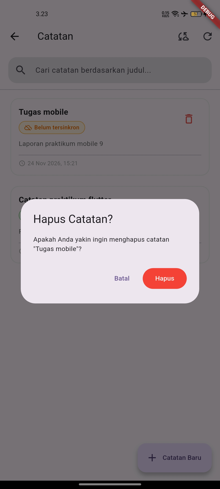 | 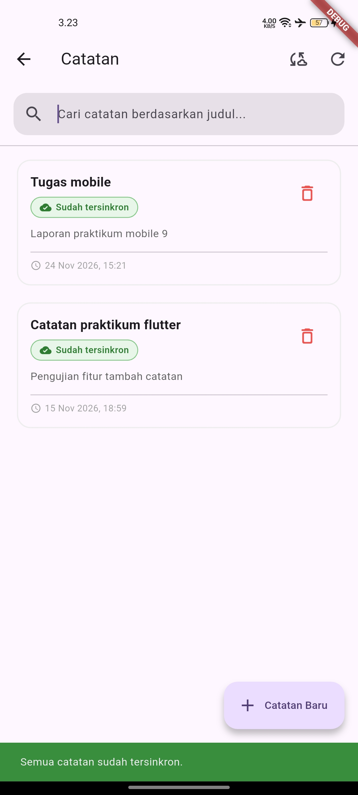 |

---

## Praktikum 3 — Debug dan Refactor ke Clean Architecture

Praktikum ini menerapkan alur debugging berbasis pengujian (*test-driven debugging*) dan memetakan kode ke layer Clean Architecture yang benar.

### 1. Debugging Test-Driven dan Pemisahan Layer

Pencarian diisolasi ke dalam Use Case murni `SearchNotes` di domain layer. Alur arsitektur dipisahkan secara tegas:
`Widget (UI)` $\rightarrow$ `Notifier (State)` $\rightarrow$ `Use Case (Domain)` $\rightarrow$ `Repository (SQLite)`. Seluruh fungsi bisnis usecase berukuran ringkas di bawah 40 baris.

### 2. Bukti Verifikasi Mesin Praktikum 3

| Dart Format Praktikum 3 | Flutter Analyze Praktikum 3 | Flutter Test Praktikum 3 |
|:---:|:---:|:---:|
| 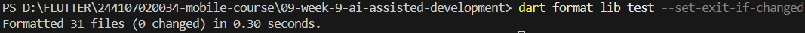 | 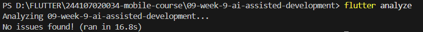 | 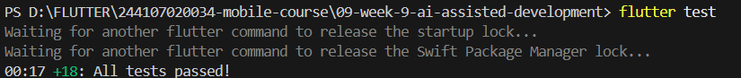 |

---

## AI Challenge

AI Challenge mensimulasikan proses peer review senior developer terhadap fitur pencarian catatan.

### 1. Evaluasi Usulan AI vs Keputusan Developer

| Temuan AI | Level | Keputusan | Alasan Teknis |
|---|:---:|:---:|---|
| Guard clause `trimmed.isEmpty` tanpa `.where()` | Saran | **TERIMA** | Menghindari alokasi list baru $O(n)$ pada query kosong. |
| Memindahkan filter ke query SQL `LIKE` SQLite | Blocker | **TOLAK** | Dataset lokal kecil, *in-memory* di use case lebih cepat (< 1 ms), reaktif bersama Riverpod, dan menjaga Clean Architecture. |
| Tombol aksi *Reset Pencarian* pada Empty State | Saran | **TERIMA + REFACTOR** | Memperbesar target sentuh tombol reset di layar mobile. |

Dokumentasi lengkap dapat dilihat pada [AI Review vs Keputusan Teknis](docs/ai-review-vs-keputusan.md).

### 2. Bukti Pengujian Mesin Refactoring

| Pengujian Test Refactoring |
|:---:|
| 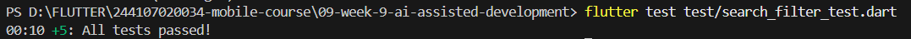 |

---

## Refleksi

1. **Satu halusinasi AI apa yang Anda temukan dan bagaimana membuktikannya?**  

   **Jawab:**

   AI mengusulkan `title.contains(query)` yang peka huruf besar/kecil serta memakai `StateProvider` yang sudah usang di Riverpod 3. Hal ini dibuktikan melalui unit test yang gagal saat mencari `"belanja"` pada judul `"Belanja Bulanan"`, serta error kompilasi pada `flutter analyze`.

2. **Prompt mana yang paling membantu dan apa yang Anda ubah?**  

   **Jawab:**

   Prompt Formula 5 Slot pada Praktikum 1. Perubahan terpenting adalah menegaskan batas arsitektur: melarang pemanggilan database dari widget dan mewajibkan filter diisolasi ke use case domain murni.

3. **Satu refactor apa yang Anda lakukan pada kode AI?**  

   **Jawab:**

   Memisahkan form catatan ke dalam *Modal Bottom Sheet* via *Floating Action Button*, mempercantik kartu catatan dengan *badge* status sinkronisasi dan tombol hapus, sehingga halaman utama fokus pada *Search Bar*.

4. **Keputusan terima/tolak mana yang paling sulit?** 
 
   **Jawab:**

   Menolak usulan AI untuk memindahkan pencarian ke query SQL `LIKE` di SQLite. Pencarian *in-memory* pada domain usecase jauh lebih cepat untuk data lokal, menjaga reaktivitas Riverpod, dan mematuhi Clean Architecture.

---

## Struktur Folder

```text
09-week-9-ai-assisted-development/
├── docs/
│   ├── ai-log.md
│   └── ai-review-vs-keputusan.md
├── lib/
│   ├── features/notes/
│   │   ├── data/
│   │   ├── domain/
│   │   └── presentation/
│   ├── main.dart
│   └── routes.dart
├── screenshots/
│   ├── 01-daftar-catatan.jpeg
│   ├── 02-search-cocok.jpeg
│   ├── 03-search-empty-state.jpeg
│   ├── 04-hapus-catatan.jpeg
│   ├── 05-sinkronisasi-catatan.jpeg
│   ├── 06-flutter-analyze-p2.png
│   ├── 07-flutter-test-p2.png
│   ├── 08-flutter-analyze-p3.png
│   ├── 09-flutter-test-p3.png
│   ├── 10-dart-format-p3.png
│   └── 11-flutter-test-refactoring.png
├── test/
│   └── search_filter_test.dart
├── analysis_options.yaml
├── pubspec.yaml
└── README.md
```

---

## Kesimpulan

Melalui praktikum Week 9, diterapkan alur kerja *AI-Assisted Development* yang bertanggung jawab (*Prompt, Generate, Verify, Test, Refactor, Explain*). AI dimanfaatkan untuk mempercepat pembuatan fitur, namun keputusan teknis dan verifikasi tetap dikendalikan oleh pengembang melalui *test-driven debugging*, kepatuhan Clean Architecture, serta pengujian otomatis yang bersih (`dart format`, `flutter analyze`, dan `flutter test`).
