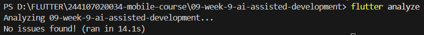
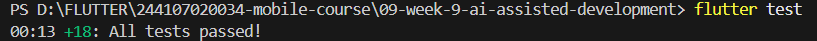
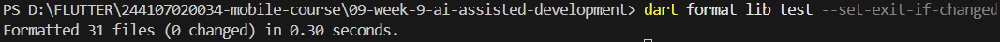
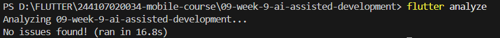
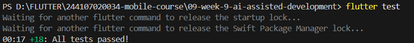

# AI Development Log

Dokumen ini mencatat log perancangan prompt, proses *context engineering*, rekaman usulan awal AI, tahapan verifikasi 6 langkah, serta siklus debugging *test-driven* pada modul AI-Assisted Development.

---

## 1. Praktikum 1 — Prompt dan Context Engineering

### 1.1 Desain Prompt dengan Formula 5 Slot

Penyusunan prompt untuk penambahan fitur pencarian (*search*) catatan pada project dirancang menggunakan Formula 5 Slot untuk memastikan hasil generate kode terstruktur, modular, dan mematuhi batas arsitektur:

| Slot | Komponen | Deskripsi dan Batasan Teknis |
|---|---|---|
| **1. Peran** | Role AI | Senior Flutter Developer spesialis Clean Architecture dan Flutter Riverpod. |
| **2. Konteks** | Arsitektur & Lingkungan | Feature-first Clean Architecture (`presentation -> domain <- data`). Menggunakan `flutter_riverpod: ^3.5.0`, SQLite (`sqflite`), dan Dio. State manajemen catatan menggunakan `FutureProvider<List<Note>>`. |
| **3. Tugas** | Fitur Spesifik | Menambahkan fitur pencarian judul catatan (case-insensitive) lengkap dengan tampilan *empty state* jika hasil pencarian tidak ditemukan. |
| **4. Batas** | Batasan Arsitektur & Ukuran | Dilarang memanggil SQLite/database langsung dari widget. Layer domain harus murni tanpa dependensi Flutter UI/Dio/SQLite. Logika filter diisolasi dalam usecase maksimal 40 baris. |
| **5. Output** | Format Hasil | Use case murni di domain layer, provider di presentation layer, integrasi search bar dan empty state di UI, 3 unit test logika search, serta panduan verifikasi CLI. |

### 1.2 Prompt Mentah (Raw Prompt)

Berikut adalah instruksi terstruktur yang diajukan ke AI coding assistant:

```text
Peran: Senior Flutter Developer spesialis Clean Architecture dan Riverpod.

Konteks:
Saya memiliki project Flutter dengan arsitektur Clean Architecture feature-first (lib/features/notes/):
- domain/entities/note.dart: class Note { final int? id; final String title; final String body; final DateTime updatedAt; final bool dirty; }
- domain/repositories/note_repository.dart: abstract class NoteRepository
- domain/usecases/get_notes.dart: class GetNotes
- presentation/providers/note_providers.dart: notesProvider (FutureProvider<List<Note>>)
- presentation/page/note_page.dart: NotesPage (ConsumerStatefulWidget)
Package: flutter_riverpod: ^3.5.0

Tugas:
Tambahkan fitur pencarian judul catatan (search notes) berbasis query text secara realtime dengan tampilan empty state bila hasil pencarian tidak cocok.

Batas & Aturan:
1. Jangan panggil SQLite atau manipulasi database dari layer presentation/widget.
2. Logika filter pencarian wajib diisolasi dalam usecase domain murni (bebas dependensi Flutter/UI/database).
3. Kode usecase tidak boleh melebihi 40 baris.
4. Jangan menghapus atau mengubah behavior fitur tambah catatan yang sudah ada.

Output yang diminta:
1. Use case murni SearchNotes di domain layer.
2. State provider di presentation layer untuk query pencarian dan hasil filter.
3. Modifikasi SearchField dan Empty State pada NotesPage.
4. Minimal 3 unit test (query cocok abaikan huruf besar/kecil, query tak cocok kembalikan empty list, query kosong kembalikan seluruh list).
5. Perintah CLI untuk memverifikasi analyzer dan test.
```

### 1.3 Context Engineering dan Kebijakan Privasi

Penyediaan konteks dilakukan secara selektif untuk mencegah kebocoran informasi kredensial:

1. **Konteks Teknis yang Disertakan:**
   - Struktur direktori folder fitur `lib/features/notes/`.
   - File entitas `note.dart` dan use case `get_notes.dart` sebagai kontrak data.
   - Versi library utama dari `pubspec.yaml` (`flutter_riverpod: ^3.5.0`, `sqflite: ^2.4.6`, `dio: ^5.11.1`).
2. **Konteks Sensitif yang Disensor (*Data Sanitization*):**
   - Token FCM disensor menjadi `FCM_TOKEN_PLACEHOLDER`.
   - Token otorisasi JWT disensor menjadi `JWT_TOKEN_PLACEHOLDER`.
   - Seluruh endpoint API produksi diganti dengan URL placeholder netral.

### 1.4 Perbandingan Prompt Buruk vs Prompt Baik

| Aspek | Prompt Buruk (*Vibe Coding*) | Prompt Baik (*Context Engineered*) |
|---|---|---|
| **Contoh Rumusan** | *"buatkan search notes yang keren di flutter dong"* | *"Tambah search judul notes. Arsitektur: presentation->domain<-data. Jangan panggil SQLite dari widget. Sertakan empty state + 3 unit test."* |
| **Konteks Arsitektur** | Tidak ada batasan layer atau state management. | Menyebutkan struktur arsitektur yang berlaku dan larangan panggilan database langsung dari widget. |
| **Dampak Kode** | AI cenderung mencampur aduk query database dan logika UI ke dalam satu widget Stateful. | Kode terpecah rapi ke layer domain (`usecase`) dan presentation (`provider` + `widget`). |
| **Kemudahan Uji** | Sangat sulit diuji secara independen (*tightly coupled*). | Logika bisnis murni mudah diuji dengan unit test tanpa memerlukan emulator atau mock database yang rumit. |

---

## 2. Praktikum 2 — Generate dan Verifikasi Search

### 2.1 Output Awal AI (Raw AI Proposal)

Berikut adalah usulan kode awal yang dihasilkan oleh AI sebelum dilakukan proses verifikasi dan audit oleh pengembang:

```dart
// USULAN AWAL AI: lib/features/notes/domain/usecases/search_notes.dart
import 'package:flutter/foundation.dart'; // Pelanggaran: Import Flutter di domain layer
import '../entities/note.dart';

class SearchNotes {
  const SearchNotes();

  List<Note> call(List<Note> notes, String query) {
    // Bug logika: Case-sensitive & tidak menangani leading/trailing whitespace
    return notes.where((note) => note.title.contains(query)).toList();
  }
}

// USULAN AWAL AI: lib/features/notes/presentation/providers/note_providers.dart (potongan)
final searchQueryProvider = StateProvider<String>((ref) => ''); // Bug: API Usang pada Riverpod 3.x
```

### 2.2 Penerapan Verifikasi 6 Langkah

1. **Langkah 1 — Membaca Tiap Baris Kode:**  
   Meneliti setiap baris logika usulan AI. Ditemukan bahwa pencarian menggunakan `contains(query)` tanpa konversi huruf kecil dan tanpa penanganan spasi berlebih.
2. **Langkah 2 — Memeriksa Import Lintas Layer:**  
   Menjalankan pemeriksaan dependensi domain:
   ```bash
   grep -rn "package:flutter" lib/features/notes/domain/
   ```
   Ditemukan `import 'package:flutter/foundation.dart';` pada usecase domain. Import tersebut segera dihapus agar domain tetap murni Dart.
3. **Langkah 3 — Memeriksa API dan Versi Package:**  
   AI mengusulkan `StateProvider<String>`, padahal `pubspec.yaml` menggunakan `flutter_riverpod: ^3.5.0` di mana `StateProvider` telah ditiadakan. Hal ini memicu error kompilasi:
   ```text
   Error: Method not found: 'StateProvider'.
   ```
   Kode direfaktor ke standar Riverpod 3.x menggunakan `Notifier` dan `NotifierProvider`.
4. **Langkah 4 — Menjalankan Analisis Statis:**  
   Menjalankan `flutter analyze` hingga bersih tanpa kesalahan (`No issues found!`).
5. **Langkah 5 — Menuliskan Unit Test dan Widget Test:**  
   Menyusun rangkaian pengujian komprehensif pada `test/search_filter_test.dart` mencakup pengujian case-insensitive, empty query, trim whitespace, dan widget test empty state.
6. **Langkah 6 — Uji Manual dan Refactor UI:**  
   Memisahkan form penambahan catatan ke dalam *Modal Bottom Sheet* via tombol *Floating Action Button*, sehingga halaman utama fokus menampilkan *Search Bar* dan daftar catatan.

### 2.3 Bukti Verifikasi Mesin Praktikum 2

| Flutter Analyze Praktikum 2 | Flutter Test Praktikum 2 |
|:---:|:---:|
|  |  |

---

## 3. Praktikum 3 — Debug dan Refactor ke Clean Architecture

### 3.1 Debugging Test-Driven dengan Test Merah

```text
1. Reproduksi -> Input query "belanja" gagal menemukan "Belanja Bulanan"
2. Isolasi    -> Pindahkan logika filter ke Use Case murni SearchNotes di domain
3. Test Merah -> Tulis unit test filterNotes(list, 'belanja') yang gagal
4. Perbaiki   -> Ubah ke .toLowerCase().contains(trimmed) sampai test hijau
5. Catat      -> Dokumentasikan akar masalah string matching di docs/ai-log.md
```

- **Akar Masalah:** AI mengasumsikan method `String.contains()` pada Dart bersifat *case-insensitive* secara bawaan.
- **Solusi TDD:** Dibuat pengujian unit gagal (*test merah*) terlebih dahulu untuk membuktikan bug, kemudian use case diperbaiki seminimal mungkin hingga pengujian berubah menjadi hijau tanpa merusak layer lainnya.

### 3.2 Refactoring ke Layer yang Benar

Struktur arsitektur dipisahkan secara tegas dengan dependensi searah:

$$\text{Widget (UI)} \longrightarrow \text{Notifier (State)} \longrightarrow \text{Use Case (Domain)} \longrightarrow \text{Repository (Data)}$$

| Layer | Komponen / Berkas | Peran dan Tanggung Jawab |
|---|---|---|
| **Widget (UI)** | `NotesPage` & `NotesList` | Menampilkan antarmuka pengguna (*Search Bar*, kartu catatan, badge status sinkronisasi, dan modal form). Bebas dari query SQLite langsung. |
| **Notifier (State)** | `SearchQueryNotifier` & `filteredNotesProvider` | Mengelola state query pencarian dan menggabungkan data catatan dengan use case filter secara reaktif. |
| **Use Case (Domain)** | `SearchNotes`, `GetNotes`, `DeleteNote`, `SyncNotes` | Berisi aturan bisnis murni: penyaringan case-insensitive, validasi string, dan logika sinkronisasi. Bebas dependensi Flutter/SQLite/Dio. |
| **Repository (Data)** | `NoteRepositoryImpl` | Menangani operasi database lokal SQLite (`query`, `insert`, `update`, `delete`) dan pemetaan data model ke entitas. |

### 3.3 Bukti Verifikasi Mesin Praktikum 3

| Dart Format Praktikum 3 | Flutter Analyze Praktikum 3 | Flutter Test Praktikum 3 |
|:---:|:---:|:---:|
|  |  |  |
