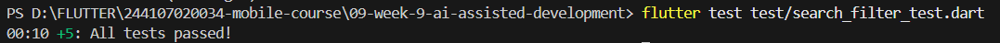

# AI Review vs Keputusan Teknis (AI Challenge)

Dokumen ini memuat catatan pelaksanaan AI Review Challenge, perbandingan usulan AI dengan keputusan teknis pengembang, serta evaluasi berbasis pengujian mesin.

---

## 1. Ruang Lingkup Review

- **Fitur:** Pencarian Judul Catatan dan Empty State (*Search Notes Feature*)
- **Berkas yang Ditinjau:**
  - `lib/features/notes/domain/usecases/search_notes.dart` (Layer Domain)
  - `lib/features/notes/presentation/providers/note_providers.dart` (Layer Presentation State)
  - `lib/features/notes/presentation/page/note_page.dart` (Layer Presentation Widget)
- **Fokus Audit:** Kebenaran logika (*correctness*), kepatuhan Clean Architecture, efisiensi reaktif Riverpod, dan kelengkapan test.

---

## 2. Prompt AI Challenge

Prompt yang diajukan kepada AI reviewer:

```text
Review kode search Flutter ini sebagai senior dev.
Konteks: feature-first (presentation->domain<-data), Riverpod, SQLite + Dio.
Fokus: kebenaran, arsitektur, test. Abaikan style.
Beri 3 temuan + level blocker/saran + alasan.
```

---

## 3. Output Awal AI Reviewer (3 Temuan)

### Temuan 1 (Saran): Efisiensi Alokasi Memori pada Query Kosong atau Spasi
> **Usulan AI:** Pada `SearchNotes.call()`, jika input hanya berisi spasi (`"   "`), setelah di-`trim()` bernilai kosong, use case harus langsung mengembalikan referensi `notes` awal tanpa memproses perulangan `.where()` untuk menghemat alokasi list baru di memori.

### Temuan 2 (Blocker / Saran): Pemindahan Filter ke Query Database SQLite
> **Usulan AI:** Mengubah pencarian menjadi query SQLite langsung `WHERE title LIKE '%query%'` melalui `NoteRepository` agar pengolahan data dilakukan langsung oleh database engine, bukan di-filter di memori Dart.

### Temuan 3 (Saran): Aksesibilitas Tombol Reset pada Empty State
> **Usulan AI:** Saat hasil pencarian kosong (*empty state* aktif), pengguna mobile hanya bisa menghapus query melalui ikon silang kecil di dalam search field. AI menyarankan penambahan tombol aksi *"Reset Pencarian"* berukuran lebih besar tepat di bawah teks pesan empty state.

---

## 4. Tabel Evaluasi: Usulan AI vs Keputusan Developer

| No | Temuan AI | Tingkat | Keputusan | Alasan Teknis & Bukti |
|:---:|---|:---:|:---:|---|
| **1** | Evaluasi guard clause `trimmed.isEmpty` mengembalikan referensi list awal tanpa `.where()`. | Saran | **TERIMA** | **Bukti:** Menghindari iterasi $O(n)$ pada query kosong. Lulus unit test `query dengan leading/trailing space tetap dapat mencocokkan` dan `query kosong kembalikan seluruh catatan`. |
| **2** | Memindahkan filter pencarian ke query SQL `LIKE %query%` di SQLite. | Blocker / Saran | **TOLAK** | **Alasan Penolakan Teknis:**<br>1) Dataset catatan lokal mahasiswa berskala kecil (< 1.000 data), pemrosesan *in-memory* pada domain layer membutuhkan waktu < 1 ms dan bebas disk I/O latency.<br>2) Menjaga sifat *reactive stream* Riverpod (`filteredNotesProvider` reaktif terhadap perubahan query realtime tanpa spam disk query).<br>3) Mematuhi Clean Architecture di mana aturan filter murni diisolasi di layer domain dan independen dari dialek SQL tertentu. |
| **3** | Menambahkan tombol aksi *Reset Pencarian* pada Empty State. | Saran | **TERIMA + REFACTOR** | **Bukti:** Meningkatkan target sentuh (*touch target area*) pada layar HP. Diuji melalui widget test `Empty State Widget Test` dan terbukti memicu pembersihan query serta menampilkan kembali daftar catatan. |

---

## 5. Bukti Pengujian Mesin

Hasil pengujian otomatis untuk memvalidasi keputusan refactoring AI Challenge:

| Pengujian Test Refactoring |
|:---:|
|  |
