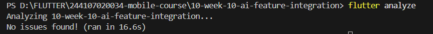
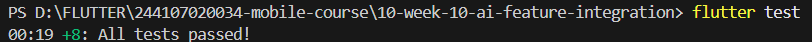
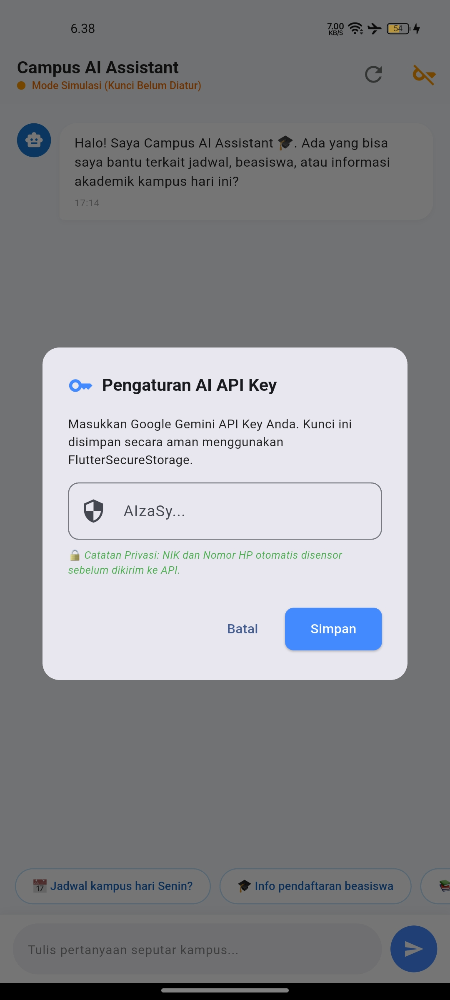
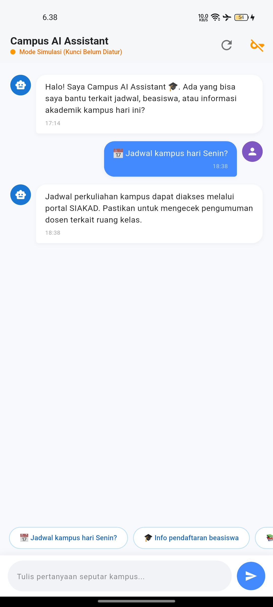
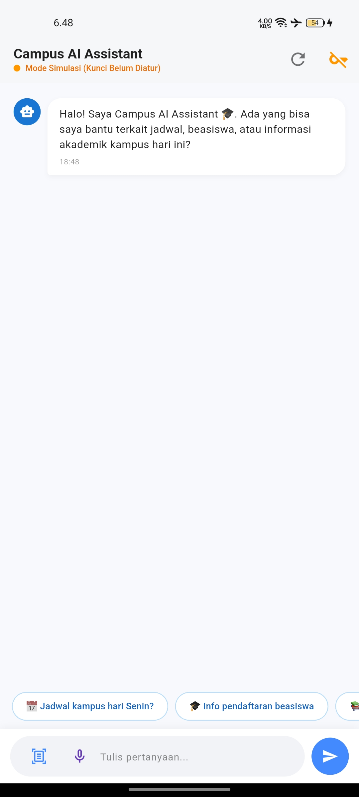

# Week 10 - Integrasi Fitur AI (AI Feature Integration)

**Nama:** Nadya Aurora Gebi Agista

**NIM:** 244107020034

---

## 1. Deskripsi Modul dan Arsitektur
Praktikum Minggu 10 berfokus pada integrasi *Chat Interface* cerdas berbasis Google Gemini API (`gemini-1.5-flash`), enkripsi kunci via `flutter_secure_storage`, manajemen state reaktif `flutter_riverpod`, serta *streaming response*.

### Aliran Data
$$\text{Flutter UI (ChatScreen)} \longleftrightarrow \text{Riverpod State} \longleftrightarrow \text{AiService} \longleftrightarrow \text{Gemini REST API}$$

- **Keamanan:** API Key disimpan terenkripsi di `FlutterSecureStorage` tanpa hardcode.
- **Privasi:** NIK dan nomor kontak disaring otomatis via `sanitizeInput()` sebelum request dikirim.
- **Efisiensi:** Menggunakan *in-memory cache* untuk pertanyaan berulang dan *fallback mode* jika offline.

---

## 2. Fitur yang Diimplementasikan
1. **Bubble Chat dan Timestamp:** Membedakan pesan pengguna dan asisten bot.
2. **Streaming Response:** Efek teks mengalir kata per kata dengan indikator mengetik.
3. **Pintasan Pertanyaan Cepat:** Tombol cepat jadwal, beasiswa, dan perpustakaan.
4. **OCR dan Speech-to-Text:** Ekstraksi teks dokumen (`recognizeText`) dan input suara (`speechToText`).
5. **Dialog Kunci API:** Konfigurasi API Key terenkripsi langsung dari antarmuka.

---

## 3. Matriks Risiko dan Mitigasi

| Risiko | Mitigasi Teknis pada Aplikasi |
|---|---|
| **Kebocoran Data** | Sensor otomatis NIK 16 digit dan nomor telepon via `sanitizeInput()`. |
| **Lonjakan Biaya** | *In-memory cache* (`_responseCache`) dan batas `maxOutputTokens: 256`. |
| **API Error / Down** | Blok `try-catch` dengan transisi otomatis ke *fallback mode* (FAQ lokal). |
| **Jawaban Halusinasi** | Penerapan *system prompt* ketat persona resmi kampus Polinema. |

---

## 4. Bukti Verifikasi Mesin

| Flutter Analyze | Flutter Test |
|:---:|:---:|
|  |  |

---

## 5. Hasil Pengujian Antarmuka

| Tampilan Awal Chat | Dialog API Key | Chat Streaming Respons | OCR dan Speech-to-Text |
|:---:|:---:|:---:|:---:|
|  |  |  |  |

---

## 6. Refleksi

1. **Fitur AI mana yang Anda integrasikan dan mengapa?**  
   
   **Jawab:**

   Fitur AI yang diintegrasikan adalah Campus AI Assistant berbasis Google Gemini dengan kemampuan multimodal, yaitu Optical Character Recognition (OCR) dan Speech-to-Text. Fitur ini dipilih untuk memudahkan mahasiswa memperoleh informasi akademik, seperti jadwal perkuliahan, informasi beasiswa, dan kebutuhan akademik lainnya tanpa harus mencarinya secara manual melalui berbagai menu aplikasi. Selain itu, fitur OCR dan Speech-to-Text memungkinkan mahasiswa menyampaikan pertanyaan melalui gambar dokumen atau suara sehingga interaksi dengan asisten AI menjadi lebih praktis.

2. **Bagaimana Anda melindungi privasi pengguna saat menggunakan AI API?**  
   
   **Jawab:**
   
   Perlindungan privasi dilakukan dengan menyaring data masukan pengguna sebelum dikirimkan ke layanan AI menggunakan fungsi sanitizeInput. Fungsi ini mendeteksi dan menyamarkan informasi sensitif, seperti NIK 16 digit, nomor telepon, dan alamat email pribadi. Selain itu, API Key disimpan menggunakan FlutterSecureStorage agar kredensial tidak ditulis secara langsung di dalam kode sumber aplikasi dan lebih terlindungi dari akses yang tidak diinginkan.

3. **Fallback apa yang Anda sediakan jika layanan AI error?**  
   
   **Jawab:**
   
   Aplikasi menyediakan mekanisme fallback menggunakan fungsi `getFallbackResponse` apabila layanan AI mengalami kendala, seperti gangguan jaringan, timeout, kuota API habis, atau API Key belum dikonfigurasi. Dalam kondisi tersebut, aplikasi akan menampilkan jawaban alternatif dari basis data lokal yang berisi informasi dasar seputar akademik, seperti panduan penggunaan portal SIAKAD, jadwal operasional perpustakaan, dan prosedur pengajuan beasiswa. Dengan demikian, pengguna tetap dapat memperoleh informasi meskipun layanan AI sedang tidak tersedia.

4. **Satu hal yang Anda pelajari tentang UX fitur AI di mobile?**  
   
   **Jawab:**
   
   Hal yang dipelajari adalah pentingnya memberikan umpan balik kepada pengguna selama AI memproses pertanyaan. Pengguna perlu mengetahui bahwa sistem sedang bekerja agar tidak mengira aplikasi mengalami gangguan. Penggunaan animasi mengetik dan tampilan teks yang muncul secara bertahap atau streaming dapat memberikan gambaran mengenai proses respons AI sekaligus membuat interaksi terasa lebih responsif.

---

## 7. Ringkasan Berkas
- `lib/ai/ai_service.dart`: Layanan Gemini API, sanitasi data, cache, OCR, dan speech-to-text.
- `lib/features/chat_screen.dart`: Antarmuka percakapan dengan Riverpod, quick prompt, dan dialog API Key.
- `lib/main.dart`: Titik masuk aplikasi dengan `ProviderScope` dan tema Material 3.
- `test/`: 11 unit & widget test terverifikasi lulus.
- `docs/ai-log.md`: Dokumentasi perancangan prompt, arsitektur, dan error handling.
