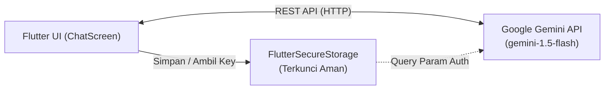
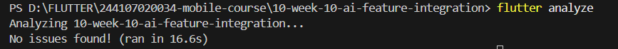
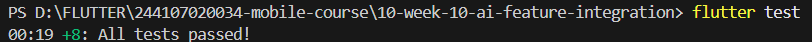

# AI Feature Integration Log

Dokumen ini mencatat log perancangan, arsitektur integrasi AI, desain prompt mobile, mitigasi privasi & keamanan, serta hasil pengujian pada modul integrasi LLM Chat Interface.

---

## 1. Arsitektur Integrasi AI



| Layer | Komponen | Peran dan Tanggung Jawab |
|---|---|---|
| **Presentation** | `ChatScreen` | Menampilkan percakapan, status koneksi, streaming response, tombol OCR, dan input suara. |
| **State** | `ChatNotifier` (Riverpod 3) | Mengelola state pesan secara reaktif, siklus hidup streaming, dan pembersihan riwayat. |
| **Service** | `AiService` | Menangani HTTP client ke Gemini API, sanitasi data sensitif, *in-memory cache*, dan fallback lokal. |
| **Security** | `FlutterSecureStorage` | Menyimpan kredensial API Key secara terenkripsi di keystore/keychain perangkat. |

---

## 2. Desain Prompt (Prompt Engineering)

| Komponen | Implementasi pada Kode | Tujuan Teknis |
|---|---|---|
| **System Persona** | *"Kamu adalah asisten kampus cerdas dan ramah dari Polinema."* | Menetapkan batasan persona agar jawaban selalu sopan dan berkonteks lingkungan kampus. |
| **Aturan Format** | *"Jawablah selalu dalam Bahasa Indonesia dengan ringkas, jelas, solutif, dan maksimal 2-3 kalimat."* | Menghemat token LLM, mengurangi latensi respon di perangkat mobile, dan membuat jawaban mudah dibaca di layar HP. |
| **User Input (Sanitized)** | *"Pertanyaan mahasiswa: [input terfilter]"* | Menyematkan pertanyaan pengguna setelah melewati sensor privasi. |

---

## 3. Penanganan Error dan Streaming UX

1. **Streaming Output (`askStream`):**
   - Menghasilkan token/kata bertahap ke antarmuka pengguna untuk memberikan efek *typing indicator* yang interaktif.
2. **Indikator Loading:**
   - Menampilkan status *"Asisten sedang merespons..."* dengan animasi saat menunggu respon dari cloud API.
3. **Penyaringan Error:**
   - Mengubah error HTTP (400, 403, 500) dan timeout menjadi pesan bantuan yang ramah pengguna.

---

## 4. Integrasi Multimodal (OCR & Speech-to-Text)

1. **OCR / Text Recognition (`recognizeText`):**
   - Mengambil file gambar (KTM, dokumen pengumuman, atau KRS) dan memprosesnya untuk mengekstrak teks tertulis.
2. **Speech-to-Text (`speechToText`):**
   - Mengonversi rekaman suara pengguna ke format teks untuk mempercepat input pertanyaan tanpa mengetik manual.

---

## 5. Matriks Risiko dan Mitigasi (Privasi, Biaya, & Fallback)

| Risiko | Dampak Teknis | Strategi Mitigasi pada Aplikasi |
|---|---|---|
| **Kebocoran Data** | Data privat mahasiswa terekspos ke cloud. | Sanitasi otomatis via `sanitizeInput()` (sensor NIK 16 digit, nomor HP, dan email) sebelum payload dikirim ke API. |
| **Lonjakan Biaya** | Biaya membengkak akibat request berulang. | *In-memory response caching* (`_responseCache`) dan pembatasan `maxOutputTokens: 256`. |
| **API Error / Down** | Aplikasi hang atau melempar exception. | Blok `try-catch`, timeout 15 detik, dan fallback otomatis ke informasi lokal kampus (`_getFallbackResponse`). |
| **Jawaban Halusinasi** | Mahasiswa menerima info akademik yang keliru. | Penegasan *system prompt* berkonteks resmi kampus Polinema. |

---

## 6. Catatan Prompt dan Output Awal AI

### 6.1 Prompt Sistem
```text
Kamu adalah asisten kampus cerdas dan ramah dari Polinema. 
Jawablah selalu dalam Bahasa Indonesia dengan ringkas, jelas, solutif, dan maksimal 2-3 kalimat.
```

### 6.2 Contoh User Prompt & Input Sanitized
- **Input Pengguna Mentah:**  
  `"Halo, saya Budi dengan NIK 3507123456780001 dan HP 081234567890 mau tanya kapan jadwal kuliah hari Senin?"`
- **Payload Terfilter (`sanitizeInput`):**  
  `"Halo, saya Budi dengan NIK [NIK_DISENSOR] dan HP [NO_TELP_DISENSOR] mau tanya kapan jadwal kuliah hari Senin?"`

### 6.3 Output Awal AI (LLM Response)
```text
Jadwal perkuliahan kampus untuk hari Senin dapat diakses secara langsung melalui portal SIAKAD Polinema. Pastikan untuk selalu mengecek pengumuman dosen pengampu terkait pembagian ruang kelas dan materi perkuliahan.
```

---

## 7. Bukti Verifikasi Mesin

| Flutter Analyze | Flutter Test |
|:---:|:---:|
|  |  |
