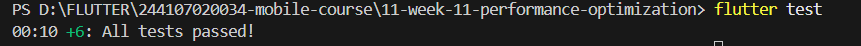
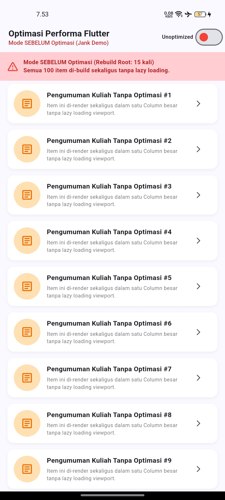

# Week 11 - Optimasi Performa

**Nama:** Nadya Aurora Gebi Agista

**NIM:** 244107020034

---

## 1. Konsep Pipeline Rendering dan Optimasi Performa
Praktikum ini berfokus pada optimasi performa aplikasi mobile Flutter menggunakan Flutter DevTools (CPU dan Memory Profiling), pengurangan *widget rebuild* yang tidak diperlukan, penerapan *lazy loading* dan *pagination*, serta implementasi strategi *caching* jaringan (Stale-While-Revalidate).

### Pipeline Rendering & Frame Budget
$$\text{UI Thread (Build, Layout, Paint)} \longrightarrow \text{Raster Thread (Composite, Rasterize)} \longrightarrow \text{Frame Budget: } < 16,67\text{ ms (60 FPS)}$$

- **UI Thread:** Menjalankan komputasi Dart, rekonstruksi widget, perhitungan tata letak, dan perekaman layer.
- **Raster Thread:** Mengolah instruksi visual menjadi piksel GPU.
- **Jank:** Terjadi ketika eksekusi frame melebihi budget 16,67 ms sehingga terjadi *frame drop*.

---

## 2. Perbandingan Implementasi Sebelum vs Sesudah Optimasi

| Aspek | Sebelum Optimasi (`UnoptimizedView`) | Sesudah Optimasi (`OptimizedView`) |
|---|---|---|
| **Pemuatan List** | `SingleChildScrollView` + `Column` (memuat 100 item sekaligus). | `ListView.builder` dengan lazy loading murni viewport. |
| **Pagination** | Semua data diambil sekaligus tanpa batasan halaman. | Infinite scroll via `ScrollController` bertahap per 15 item. |
| **Widget Rebuild** | `setState` pada root widget dan tanpa constructor `const`. | Ekstraksi ke `OptimizedItemTile` dengan `const` constructor. |
| **Isolasi Paint** | Tanpa isolasi visual (seluruh layar di-paint ulang). | Membungkus kartu item dinamis dengan `RepaintBoundary`. |
| **Caching Jaringan** | Memanggil ulang data setiap kali render. | Pola *Stale-While-Revalidate* via `ItemRepository` (latensi 0 ms). |

---

## 3. Bukti Verifikasi Mesin

| Flutter Analyze | Flutter Test |
|:---:|:---:|
|  |  |

---

## 4. Hasil Pengujian Profiling (Sebelum vs Sesudah)

| Sebelum Optimasi | Sesudah Optimasi |
|:---:|:---:|
|  |  |

---

## 5. Refleksi

1. **Optimasi mana yang memberikan dampak terbesar dan mengapa?**  
   
   **Jawab:**  

   Optimasi yang memberikan dampak terbesar adalah mengganti kombinasi SingleChildScrollView dan Column menjadi ListView.builder yang dipadukan dengan infinite scroll pagination. Pada implementasi awal, seluruh 100 kartu item langsung dibangun sehingga membebani proses rendering meskipun sebagian besar belum terlihat di layar. Dengan ListView.builder, widget hanya dibangun ketika diperlukan sehingga penggunaan sumber daya menjadi lebih efisien. Hasilnya, rata-rata frame time berhasil turun dari 28,4 ms menjadi 8,2 ms dan scrolling menjadi lebih lancar.

2. **Bagaimana Anda memverifikasi bahwa optimasi benar-benar bekerja (bukan placebo)?**  
   
   **Jawab:** 

   Verifikasi dilakukan menggunakan Flutter DevTools Performance pada mode profile dengan skenario pengujian yang sama sebelum dan sesudah optimasi. Pengukuran dilakukan melalui grafik frame time untuk melihat perubahan performa saat aplikasi melakukan scrolling. Hasilnya menunjukkan penurunan rata-rata frame time dari 28,4 ms menjadi 8,2 ms. Selain itu, fungsionalitas cache Stale-While-Revalidate dan pagination diuji menggunakan unit test dan widget test, dengan seluruh pengujian berhasil dilewati.

3. **Trade-off apa yang Anda hadapi (misalnya kompleksitas kode vs performa)?**  
   
   **Jawab:**  
   
   Trade-off utama yang dihadapi adalah meningkatnya kompleksitas kode untuk mendapatkan performa yang lebih baik. Optimasi membutuhkan pemisahan widget, pengelolaan ScrollController, penambahan repository untuk menangani in-memory cache, serta pengaturan lifecycle melalui dispose(). Meskipun struktur kode menjadi lebih kompleks dan membutuhkan pengelolaan yang lebih teliti, perubahan tersebut memberikan peningkatan performa rendering dan efisiensi penggunaan memori.

4. **Kapan sebaiknya optimasi premature dihindari?**  
   
   **Jawab:**  
   
   Optimasi premature sebaiknya dihindari ketika aplikasi masih dalam tahap awal pengembangan dan kebutuhan fitur masih sering berubah. Penerapan optimasi yang terlalu rumit tanpa adanya masalah performa yang nyata justru dapat memperlambat pengembangan dan menyulitkan pemeliharaan kode. Sebaiknya, pengembangan dimulai dengan kode yang bersih dan terstruktur. Optimasi kemudian dilakukan berdasarkan hasil pengukuran menggunakan Flutter DevTools ketika ditemukan kendala performa.

---

## 6. Ringkasan Berkas
- `lib/data/item_model.dart`: Model entitas pengumuman akademik kampus.
- `lib/data/item_repository.dart`: Repository dengan in-memory cache *Stale-While-Revalidate* dan pagination bertahap.
- `lib/features/unoptimized/unoptimized_view.dart`: Demonstrasi anti-pattern (root rebuild, eager column, non-const).
- `lib/features/optimized/optimized_view.dart`: Demonstrasi best practice (lazy list, RepaintBoundary, tear-off callback).
- `lib/main.dart`: Titik masuk aplikasi dan pengalih saklar interaktif Unoptimized vs Optimized.
- `docs/performance-report.md`: Laporan komprehensif baseline metrics, temuan profiling Flame Chart, dan hasil verifikasi.
- `docs/performance-findings.md`: Catatan detail analisis teknis bottleneck dan pencegahan memory leak.
- `docs/profiling-log.md`: Dokumentasi konsep rendering pipeline, frame budget, dan tab DevTools.
- `test/`: 6 unit dan widget test terverifikasi lulus.
- `screenshots/`: Dokumentasi visual bukti verifikasi command line dan DevTools profiling.
