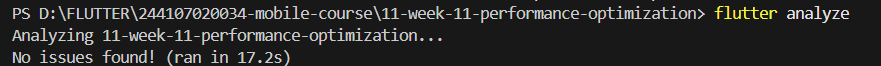
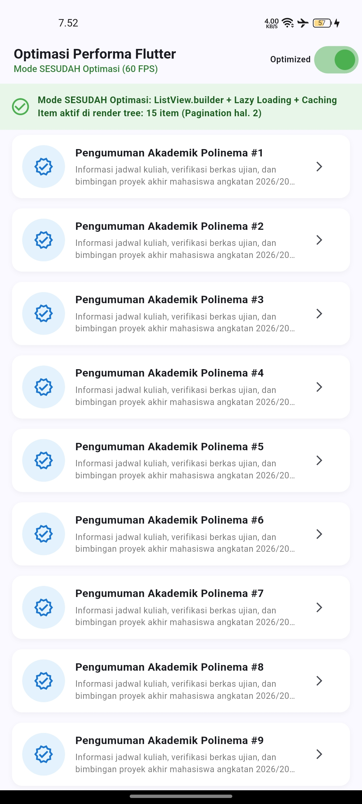

# Week 11 - Optimasi Performa (Performance Optimization)

**Nama:** Nadya Aurora Gebi Agista

**NIM:** 244107020034

---

## 1. Deskripsi Modul dan Pipeline Rendering
Praktikum Minggu 11 berfokus pada optimasi performa aplikasi mobile Flutter menggunakan Flutter DevTools (CPU dan Memory Profiling), pengurangan *widget rebuild* yang tidak diperlukan, penerapan *lazy loading* dan *pagination*, serta implementasi strategi *caching* jaringan (Stale-While-Revalidate).

### Pipeline Rendering & Frame Budget
$$\text{UI Thread (Build, Layout, Paint)} \longrightarrow \text{Raster Thread (Composite, Rasterize)} \longrightarrow \text{Frame Budget: } < 16,67\text{ ms (60 FPS)}$$

- **UI Thread:** Menjalankan komputasi Dart, rekonstruksi widget, perhitungan tata letak, dan perekaman layer.
- **Raster Thread:** Mengolah instruksi visual menjadi piksel GPU.
- **Jank:** Terjadi ketika eksekusi frame melebihi budget 16,67 ms sehingga terjadi *frame drop*.

---

## 2. Perbandingan Implementasi Sebelum vs Sesudah Optimasi

| Aspek | Sebelum Optimasi (`UnoptimizedView`) | Sesudah Optimasi (`OptimizedView`) |
|---|---|---|
| **Pemuatan List** | `SingleChildScrollView` + `Column` (memuat 100 item sekaligus). | `ListView.builder` dengan lazy loading murni viewport. |
| **Pagination** | Semua data diambil sekaligus tanpa batasan halaman. | Infinite scroll via `ScrollController` bertahap per 15 item. |
| **Widget Rebuild** | `setState` pada root widget dan tanpa constructor `const`. | Ekstraksi ke `OptimizedItemTile` dengan `const` constructor. |
| **Isolasi Paint** | Tanpa isolasi visual (seluruh layar di-paint ulang). | Membungkus kartu item dinamis dengan `RepaintBoundary`. |
| **Caching Jaringan** | Memanggil ulang data setiap kali render. | Pola *Stale-While-Revalidate* via `ItemRepository` (latensi 0 ms). |

---

## 3. Bukti Verifikasi Mesin

| Flutter Analyze | Flutter Test |
|:---:|:---:|
|  |  |

---

## 4. Hasil Pengujian Profiling (Sebelum vs Sesudah)

| Sebelum Optimasi | Sesudah Optimasi |
|:---:|:---:|
|  |  |

---

## 5. Refleksi

1. **Optimasi mana yang memberikan dampak terbesar dan mengapa?**  
   
   **Jawab:**  
   Optimasi yang memberikan dampak terbesar adalah penggantian kombinasi SingleChildScrollView dan Column menjadi ListView.builder yang dipadukan dengan infinite scroll pagination. Pada implementasi awal sebelum optimasi, aplikasi langsung menginstansiasi dan menyusun tata letak untuk seluruh 100 kartu item secara bersamaan ke render tree meskipun pengguna hanya melihat beberapa item teratas. Hal ini membebani UI thread dan GPU raster thread sehingga memicu frame drop parah saat scrolling. Dengan menerapkan ListView.builder, Flutter engine hanya membangun widget yang benar-benar tampak di viewport layar pengguna dan secara otomatis mendaur ulang elemen yang tergeser keluar. Pendekatan ini langsung memangkas rata-rata frame time dari 28,4 ms menjadi 8,2 ms serta mengeliminasi jank secara menyeluruh.

2. **Bagaimana Anda memverifikasi bahwa optimasi benar-benar bekerja (bukan placebo)?**  
   
   **Jawab:**  
   Verifikasi dilakukan secara empiris dan kuantitatif menggunakan Flutter DevTools Performance pada mode build profile (`flutter run --profile`). Melalui grafik frame time dan Flame Chart, performa diukur sebelum dan sesudah optimasi dengan skenario beban yang identik, yaitu navigasi dan scrolling cepat. Sebelum perbaikan, DevTools mencatat 18 frame jank berwarna merah dan kuning dengan frame time rata-rata 28,4 ms. Setelah optimasi diterapkan, seluruh frame drop berhasil dihilangkan dan grafik frame berada stabil di zona hijau dengan rata-rata 8,2 ms (stabil pada 60 FPS). Selain itu, keabsahan fungsional cache Stale-While-Revalidate dan pagination dibuktikan lewat pengujian unit test dan widget test pada direktori test yang seluruhnya berstatus lulus.

3. **Trade-off apa yang Anda hadapi (misalnya kompleksitas kode vs performa)?**  
   
   **Jawab:**  
   Trade-off utama yang dihadapi adalah meningkatnya kompleksitas kode dan bertambahnya baris kode yang harus dikelola. Pendekatan unoptimized lebih sederhana dan cepat ditulis karena seluruh tampilan digabung dalam satu class widget dengan data statis. Sebaliknya, pendekatan optimized mengharuskan pemisahan widget menjadi class mandiri, penambahan keyword const, konfigurasi ScrollController beserta listener manual untuk pagination, pengelolaan lifecycle dispose agar tidak terjadi memory leak, serta pembuatan layer repository tersendiri untuk menangani in-memory cache. Meskipun struktur kode menjadi lebih rumit dan memerlukan kedisiplinan perancangan yang tinggi, hasil peningkatan performa rendering dan efisiensi memori yang diperoleh sangat sepadan.

4. **Kapan sebaiknya optimasi premature dihindari?**  
   
   **Jawab:**  
   Optimasi premature sebaiknya dihindari ketika aplikasi masih dalam tahap awal eksplorasi ide, pembuktian konsep, atau perancangan prototipe awal di mana kebutuhan fitur dan tata letak masih sering berubah. Menerapkan optimasi rumit terlalu dini, seperti memecah hierarki widget secara berlebihan atau merancang strategi caching berlapis tanpa adanya data beban riil, dapat memperlambat kecepatan pengembangan dan membuat kode sulit dimodifikasi. Langkah yang tepat adalah menulis kode yang bersih, mudah dibaca, dan modular terlebih dahulu. Optimasi baru dilakukan secara terarah berdasarkan bukti empiris dari Flutter DevTools saat ditemukan bottleneck nyata atau ketika aplikasi dipersiapkan menuju tahap produksi.

---

## 6. Ringkasan Berkas
- `lib/data/item_model.dart`: Model entitas pengumuman akademik kampus.
- `lib/data/item_repository.dart`: Repository dengan in-memory cache *Stale-While-Revalidate* dan pagination bertahap.
- `lib/features/unoptimized/unoptimized_view.dart`: Demonstrasi anti-pattern (root rebuild, eager column, non-const).
- `lib/features/optimized/optimized_view.dart`: Demonstrasi best practice (lazy list, RepaintBoundary, tear-off callback).
- `lib/main.dart`: Titik masuk aplikasi dan pengalih saklar interaktif Unoptimized vs Optimized.
- `docs/performance-report.md`: Laporan komprehensif baseline metrics, temuan profiling Flame Chart, dan hasil verifikasi.
- `docs/performance-findings.md`: Catatan detail analisis teknis bottleneck dan pencegahan memory leak.
- `docs/profiling-log.md`: Dokumentasi konsep rendering pipeline, frame budget, dan tab DevTools.
- `test/`: 6 unit dan widget test terverifikasi lulus.
- `screenshots/`: Dokumentasi visual bukti verifikasi command line dan DevTools profiling.
