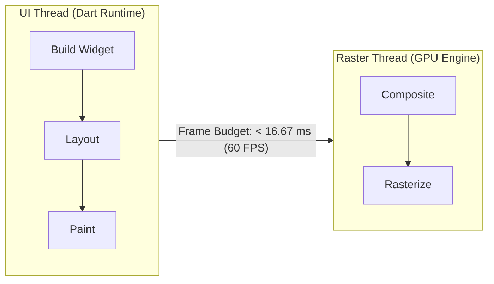

# Log Profiling dan Optimasi Performa

Dokumen ini mencatat pemahaman konsep pipeline rendering Flutter, panduan penggunaan Flutter DevTools, serta rekaman hasil profiling performa CPU dan memori.

---

## 1. Konsep Pipeline Rendering Flutter



- **Frame Budget:** 16,67 ms per frame untuk mencapai 60 FPS yang mulus (atau 8,33 ms untuk 120 FPS).
- **Definisi Jank:** Terjadi ketika proses pada UI Thread atau Raster Thread melebihi budget frame sehingga terjadi *frame drop* yang terlihat patah-patah oleh pengguna.
- **Tanggung Jawab UI Thread:** Eksekusi kode Dart, perancangan pohon widget (*build*), penentuan ukuran (*layout*), dan perekaman instruksi visual (*paint*).
- **Tanggung Jawab Raster Thread:** Komposisi layer visual (*composite*) dan penerjemahan instruksi visual ke dalam piksel GPU (*rasterize*).

---

## 2. Kategori Optimasi Performa

| Kategori | Potensi Masalah | Solusi & Strategi Optimasi | Alat Pemantau |
|---|---|---|---|
| **CPU / Build** | Rebuild widget berulang, komputasi berat di UI Thread. | Gunakan `const`, isolasi state dengan Riverpod, pindahkan komputasi berat ke `compute()` / *isolate*. | DevTools Performance (Flame Chart, Timeline) |
| **Memori** | Memory leak, penumpukan objek yang tidak terbuang. | `dispose()` controller, hindari global reference tak terbatas, profiling snapshot heap. | DevTools Memory (Heap Snapshot, Allocation Trace) |
| **Gambar & Aset** | Gambar beresolusi terlalu besar menyebabkan raster jank. | Terapkan `cacheWidth`/`cacheHeight`, kompresi format WebP, gunakan `RepaintBoundary`. | DevTools Memory & Raster Timeline |
| **Jaringan & I/O** | Permintaan HTTP berulang tanpa cache. | Gunakan *in-memory cache*, SQLite offline-first, dan batasi payload JSON. | DevTools Network & Dio Interceptor |

---

## 3. Panduan Praktik Profiling dengan DevTools

1. **Jalankan Aplikasi pada Mode Profile:**
   ```bash
   flutter run --profile
   ```
   *(Mode `--profile` merefleksikan performa nyata tanpa overhead debug).*

2. **Buka DevTools:**
   Akses antarmuka web DevTools melalui URL yang disediakan pada terminal saat menjalankan aplikasi.

3. **Menganalisis CPU (Tab Performance):**
   - Tekan tombol **Record** lalu lakukan interaksi normal (scroll daftar data, navigasi halaman).
   - Tekan **Stop**, periksa grafik **Frame Chart**:
     - 🟩 **Hijau:** `< 16,67 ms` (Lancar / Optimal 60 FPS).
     - 🟥 **Merah:** `> 16,67 ms` (Jank / Frame Drop melebihi frame budget).
   - Analisis **Flame Chart** pada frame merah untuk mengidentifikasi method Dart yang paling memakan waktu.

4. **Menganalisis Memori (Tab Memory):**
   - Ambil **Heap Snapshot** sebelum dan sesudah navigasi.
   - Periksa apakah instance widget atau controller masih tertahan di memori (*leak detection*).

---

## 4. Teknik Mengurangi Widget Rebuild

| Teknik | Masalah Sebelum Optimasi | Implementasi Sesudah Optimasi | Keuntungan Teknis |
|---|---|---|---|
| **`const` Constructor** | Seluruh sub-tree direkonstruksi ulang saat parent rebuild. | Menambahkan keyword `const` pada widget statis. | Menghemat alokasi memori Dart dan melewati fase build elemen yang tidak berubah. |
| **Ekstraksi Widget** | Seluruh build method dieksekusi ulang saat ada perubahan state kecil. | Memisahkan komponen kompleks menjadi class `StatelessWidget` terpisah. | Membatasi cakupan *rebuild boundary* hanya pada widget yang terpengaruh. |
| **`RepaintBoundary`** | Perubahan visual pada satu komponen memicu repaint seluruh layar. | Membungkus widget dinamis/kompleks dengan `RepaintBoundary()`. | Mengisolasi render box ke dalam layer terpisah agar GPU tidak meraster ulang elemen di sekitarnya. |
| **Riverpod `select`** | Widget me-rebuild saat properti lain dalam state berubah. | Menggunakan `ref.watch(provider.select((s) => s.property))`. | Hanya merespons perubahan properti spesifik yang dibutuhkan oleh widget tersebut. |
| **Tear-off / Method Ref** | Pembuatan objek *closure* anonymous function baru di setiap frame. | Menetapkan callback langsung via `onPressed: _handleAction`. | Menghindari instansiasi fungsi anonymous dan mengurangi tekanan alokasi memori GC. |

---

## 5. Lazy Loading, Pagination, dan Optimasi Gambar

1. **Lazy Loading (`ListView.builder`):**
   - Hanya me-render item yang berada di dalam area tampak (*viewport*).
   - Menghindari instansiasi ratusan/ribuan widget sekaligus yang dapat menyebabkan *out-of-memory* (OOM).

2. **Pagination (Infinite Scroll):**
   - Menggunakan `ScrollController` untuk mendeteksi ambang batas scroll (`maxScrollExtent - 200`).
   - Memuat data per halaman (misal: 15–20 data/halaman) sehingga transfer jaringan dan memori terkendali.

3. **Optimasi Gambar:**
   - **`memCacheWidth` & `memCacheHeight`:** Mendekode gambar di memori sesuai ukuran tampil di layar (misal 300x200 px), bukan resolusi asli kamera (4000x3000 px). Menghemat memori hingga 90%.
   - **Disk Caching:** Menyimpan gambar di cache lokal untuk mencegah download ulang saat scroll.
   - **Placeholder & Shimmer:** Memberikan umpan balik visual instan sebelum gambar selesai dimuat.

---

## 6. Optimasi Jaringan dan Strategi Caching

| Strategi Caching | Alur Kerja | Kasus Penggunaan Ideal |
|---|---|---|
| **Cache-First** | Baca cache $\rightarrow$ jika kosong fetch API $\rightarrow$ simpan cache. | Data yang jarang berubah (pengaturan, master fakultas/prodi). |
| **Network-First** | Fetch API $\rightarrow$ simpan cache $\rightarrow$ fallback ke cache jika offline/gagal. | Data kritis & real-time (jadwal ujian mendesak, pengumuman darurat). |
| **Stale-While-Revalidate** | Tampilkan cache lama instan $\rightarrow$ fetch background $\rightarrow$ perbarui UI & cache. | Feed berita kampus, daftar catatan, katalog buku perpustakaan. |
| **Cache-Only (Offline)** | Hanya membaca dari database lokal (SQLite/Hive). | Mode offline penuh saat tidak ada konektivitas. |

### Praktik Jaringan Efisien:
1. **Dio Retry Interceptor:** Menangani kegagalan jaringan sementara secara otomatis dengan *exponential backoff*.
2. **Payload Kompak:** Hanya meminta field yang diperlukan (*selective fields*) dan menggunakan kompresi data.
3. **HTTP Caching / ETag:** Menghindari pengunduhan ulang respon yang tidak berubah dengan header `If-None-Match`.
