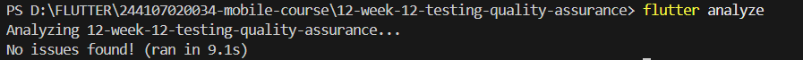
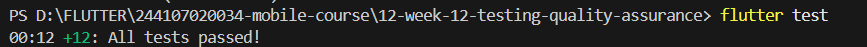
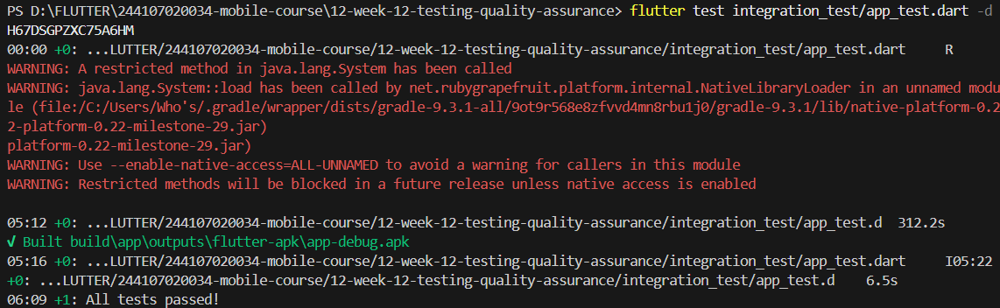
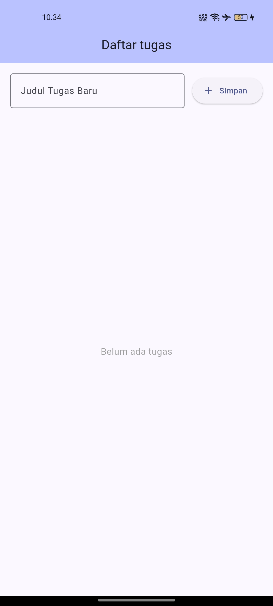
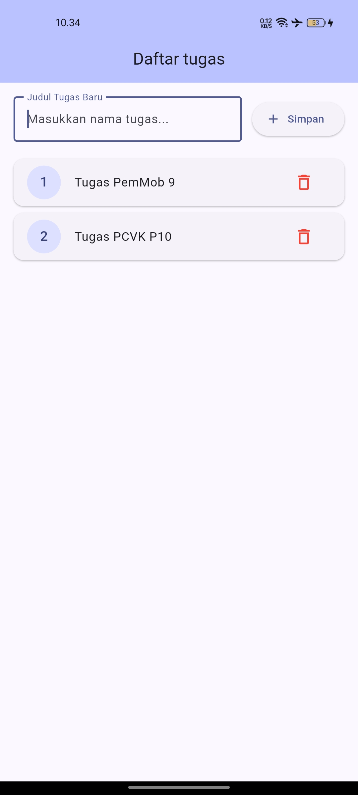

# Week 12 - Testing and Quality Assurance

**Nama:** Nadya Aurora Gebi Agista

**NIM:** 244107020034

---

## 1. Strategi Pengujian Aplikasi Flutter
Praktikum Minggu 12 berfokus pada penerapan piramida pengujian untuk menjaga kualitas kode dan mencegah regresi pada aplikasi mobile Flutter.

| Jenis Pengujian | Komponen yang Diuji | Fokus Pengujian | Berkas Uji |
|---|---|---|---|
| **Unit Testing** | Logika fungsi terisolasi | Validasi judul tugas dan kasus tepi (*edge cases*) | `test/is_valid_task_title_test.dart` |
| **Fake Dependency** | Lapisan sumber data asinkron | Pengujian data sukses dan penanganan error tanpa jaringan | `test/task_service_test.dart` |
| **Widget Testing** | Antarmuka dan interaksi UI | Tampilan awal, input teks, tombol simpan, dan aksi hapus | `test/widget_test.dart` |
| **Integration Testing** | Alur aplikasi menyeluruh | Verifikasi alur end-to-end penambahan tugas | `integration_test/app_test.dart` |

---

## 2. Matriks Skenario Pengujian

| Skenario | Deskripsi Kasus Uji | Ekspektasi Hasil | Status |
|---|---|---|:---:|
| **Normal** | Input judul valid `"Baca materi"` lalu simpan | Tugas masuk ke daftar dan input field bersih | **Lulus** |
| **Kasus Tepi** | Input dengan spasi berlebih `"   Tugas Mobile   "` | Teks di-*trim* otomatis dan diterima sebagai valid | **Lulus** |
| **Kegagalan** | Input teks kosong `""` atau hanya spasi | Menampilkan pesan error `"Judul tugas tidak boleh kosong"` | **Lulus** |
| **Fake Data** | Pengambilan data melalui `FakeTaskRepository` | Mengembalikan list tugas secara asinkron | **Lulus** |
| **Fake Error** | Simulasi kegagalan koneksi data repository | Melempar exception tanpa berubah menjadi list kosong | **Lulus** |
| **Aksi Hapus** | Menekan tombol ikon hapus pada kartu tugas | Item terhapus dari daftar tugas | **Lulus** |

---

## 3. Bukti Verifikasi Mesin dan CLI

| Flutter Analyze | Flutter Test | Flutter Test Integration |
|:---:|:---:|:---:|
|  |  |  |

- **Analisis Statis:** `No issues found!` (0 error, 0 warning).
- **Hasil Pengujian:** 12/12 pengujian berstatus lulus (100% Pass Rate).
- **Cakupan Kode (`flutter test --coverage`):** Total *code coverage* mencapai **96,6%** (`is_valid_task_title.dart` 100%, `task_service.dart` 100%, `main.dart` 94,4%).

---

## 4. Pengujian Antarmuka Aplikasi

| Tampilan Awal (Daftar Kosong) | Menambahkan Tugas |
|:---:|:---:|
|  |  |

Pengujian antarmuka memvalidasi bahwa state awal menampilkan pesan kosong dan form input dapat menerima data lalu merender kartu tugas secara responsif.

---

## 5. Refleksi

1. **Bug apa yang paling mungkin terlewat tanpa pengujian yang Anda tulis?**  
   
   **Jawab:**  

   Bug yang mungkin terlewat adalah validasi judul tugas yang hanya berisi spasi atau tab serta penanganan kegagalan saat pengambilan data. Tanpa unit test pada isValidTaskTitle, judul yang hanya berisi spasi berisiko dianggap valid dan tersimpan. Selain itu, tanpa pengujian menggunakan fake repository pada TaskService, kesalahan saat mengambil data mungkin tidak tertangani dengan baik sehingga pengguna tidak mengetahui bahwa terjadi kegagalan pengambilan data.

2. **Bagian mana yang perlu fake, dan bagaimana fake itu membuat pengujian lebih konsisten?**  
   
   **Jawab:**  
   
   Bagian yang perlu menggunakan fake adalah TaskRepository, yaitu bagian yang menangani pengambilan data. Dengan FakeTaskRepository, pengujian dapat dilakukan tanpa bergantung pada koneksi internet, server, maupun database asli. Perilaku pengambilan data dapat diatur sesuai skenario yang ingin diuji, baik ketika berhasil maupun gagal, sehingga hasil pengujian lebih konsisten dan mudah diulang.

3. **Apa perbedaan nilai yang diberikan pengujian widget dan pengujian integrasi pada fitur Anda?**  
   
   **Jawab:**  
   
   Pengujian widget membantu memastikan komponen antarmuka dan interaksi pengguna berjalan sesuai harapan, seperti tampilan daftar tugas dan respons tombol. Sementara itu, pengujian integrasi memastikan seluruh alur aplikasi dapat berjalan dengan baik, mulai dari interaksi pengguna, proses pengambilan data, hingga navigasi antarhalaman. Keduanya saling melengkapi untuk memastikan fitur berjalan sesuai kebutuhan.

