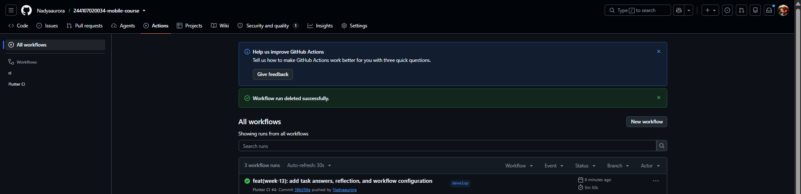
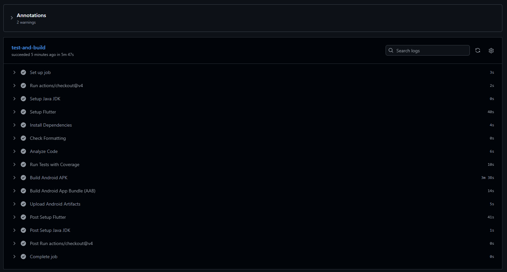
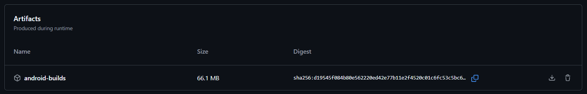

# Week 13 - CI/CD dan Otomatisasi Pipeline

**Nama:** Nadya Aurora Gebi Agista

**NIM:** 244107020034

---

## 1. Konsep CI/CD dan Pipeline Otomatisasi
Praktikum Minggu 13 berfokus pada implementasi Continuous Integration dan Continuous Delivery menggunakan GitHub Actions untuk aplikasi mobile Flutter.

Pipeline ini mengotomatiskan siklus pengujian dan build setiap kali terjadi push atau pull request pada branch main dan develop, mencakup pemeriksaan format, analisis statis, pengujian unit, serta kompilasi artefak rilis Android.

---

## 2. Struktur Workflow GitHub Actions
Workflow didefinisikan pada berkas `.github/workflows/flutter-ci.yml` dengan tahapan pekerjaan berikut:

| Tahapan Pipeline | Perintah yang Dijalankan | Fungsi dan Tujuan |
|---|---|---|
| **Environment Setup** | `actions/setup-java@v4` dan `subosito/flutter-action@v2` | Menyiapkan Java JDK 17 dan Flutter stable |
| **Dependency Install** | `flutter pub get` | Mengunduh dependensi paket aplikasi |
| **Code Formatting** | `dart format --output=none --set-exit-if-changed lib test` | Memeriksa kepatuhan format kode resmi Dart |
| **Static Analysis** | `flutter analyze --no-fatal-infos` | Mendeteksi error sintaksis dan warning linting |
| **Unit Testing** | `flutter test --coverage` | Menjalankan seluruh pengujian dan merekam coverage |
| **Build APK** | `flutter build apk --release` | Menghasilkan file biner APK rilis |
| **Build App Bundle** | `flutter build appbundle --release` | Menghasilkan format distribusi AAB untuk Google Play |
| **Artifact Upload** | `actions/upload-artifact@v4` | Menyimpan file APK dan AAB pada tab Actions |

---

## 3. Bukti Eksekusi Workflow dan Artefak

| Ringkasan Status Workflow | Rincian Tahapan Pipeline | Hasil Artefak Android Builds |
|:---:|:---:|:---:|
|  |  |  |

- **Pemicu Workflow:** Push commit pada branch develop dan pull request ke main.
- **Hasil Eksekusi:** Seluruh tahapan pipeline sukses berstatus hijau (*Passed*) dalam waktu 5 menit 47 detik.
- **Artefak:** `android-builds` berukuran 66.1 MB berisi biner `app-release.apk` dan `app-release.aab`.

---

## 4. Versi dan Mitigasi Risiko Keamanan
- **Semantic Versioning:** Versi saat ini adalah `1.0.0+1`. Rilis fitur baru berikutnya direncanakan menggunakan `1.1.0+2` dengan penandaan rilis Git Tag `v1.1.0`.
- **Penyimpanan Credential:** Kredensial rahasia, keystore signing, dan token privat disimpan menggunakan GitHub Actions Secrets tanpa dicetak pada log runner.
- **Batasan `--dart-define`:** Nilai parameter kompilasi tidak digunakan untuk menyimpan secret sensitif karena dapat diekstrak dari file APK klien.

---

## 5. Refleksi

**1. Masalah apa yang ditemukan otomatis sebelum perubahan di-merge?**

**Jawab:**

Masalah yang dapat ditemukan secara otomatis oleh pipeline CI meliputi format kode yang tidak konsisten melalui `dart format`, kesalahan kode melalui `flutter analyze`, serta kegagalan pengujian dan regresi melalui `flutter test`. Selain itu, jika pipeline menjalankan proses build APK atau AAB, kesalahan kompilasi juga dapat terdeteksi sebelum perubahan digabungkan ke branch utama.

**2. Informasi apa yang Anda butuhkan untuk menyelidiki build yang gagal?**

**Jawab:**

Informasi yang dibutuhkan meliputi log error pada tahapan yang gagal di GitHub Actions, nama berkas dan baris kode yang bermasalah, serta hasil pengujian jika kegagalan terjadi pada tahap testing. Selain itu, commit hash, perubahan kode, dan versi Flutter SDK juga diperlukan untuk membantu menemukan penyebab kegagalan build.

**3. Bagian mana yang masih perlu persetujuan atau pemeriksaan manual sebelum rilis?**

**Jawab:**

Bagian yang masih memerlukan pemeriksaan manual adalah tampilan dan kenyamanan aplikasi saat digunakan di perangkat nyata, performa aplikasi, serta kesesuaian fitur dengan kebutuhan pengguna. Selain itu, pemeriksaan keamanan dan izin akses juga diperlukan sebelum aplikasi dirilis. Hal ini karena keberhasilan pipeline CI/CD belum tentu menjamin aplikasi sepenuhnya siap digunakan oleh pengguna.
